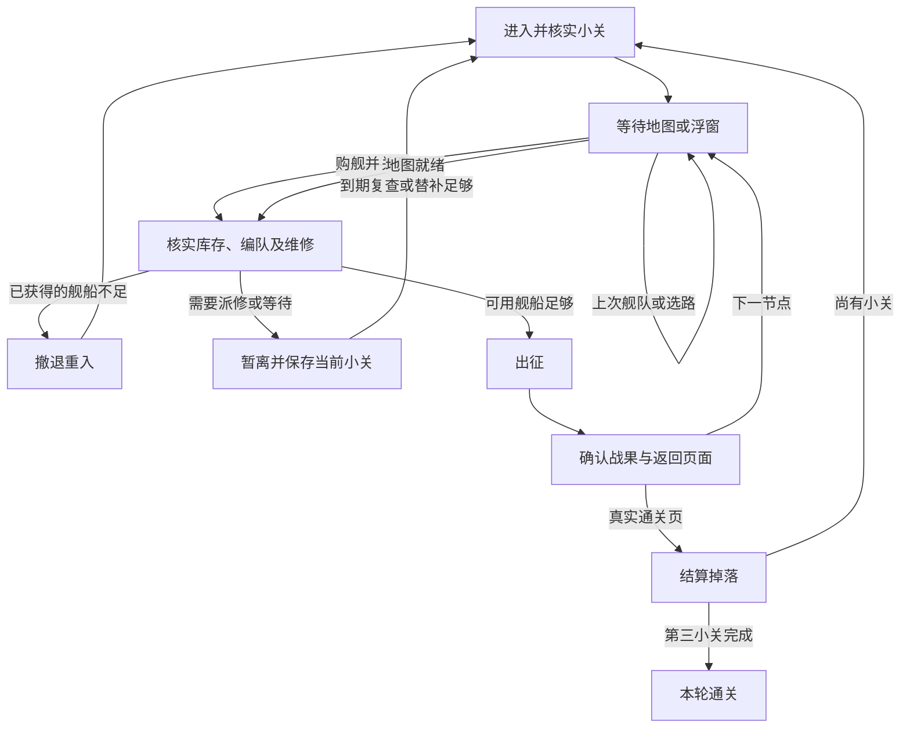

# 决战模式使用指南

> 详解 AutoWSGR v2 的决战 (Decisive Battle) 系统 — 最复杂的战斗模式。

---

## 目录

- [1. 决战概述](#1-决战概述)
- [2. 配置](#2-配置)
- [3. 基本用法](#3-基本用法)
- [4. 架构与状态机](#4-架构与状态机)
- [5. 舰队选择策略](#5-舰队选择策略)
- [6. 进阶用法](#6-进阶用法)
- [7. 与 v1 对比](#7-与-v1-对比)

---

## 1. 决战概述

决战是《战舰少女R》中最复杂的战斗模式，具有以下特点：

- **3 个小关** (Stage 1~3)，通过全部后大关通关
- **每个小关多节点**，需要逐节点推进
- **舰队获取**: 从卡池中选择舰船组建临时舰队
- **前进点选择**：识别两张或三张路线卡，选择最左侧路线
- **舰船维修**：按损伤标准快修，也可配置维修时长阈值，暂离入浴后继续本小关
- **撤退**: 撤退会清空当前章节所有进度

---

## 2. 配置

### DecisiveConfig

```python
from autowsgr.infra import DecisiveConfig

config = DecisiveConfig(
    chapter=6,                    # 决战章节 (1~6)
    level1=[                      # 一级舰队 (优先选择)
        "鲃鱼", "U-1206", "射水鱼",
        "U-96", "U-1405", "U-47",
    ],
    level2=[                      # 二级舰队 (补充选择)
        "U-81", "大青花鱼", "M-296",
        "U-505", "伊-25",
    ],
    flagship_priority=[           # 旗舰优先级
        "U-1405", "U-47", "U-1206",
    ],
    repair_level=2,               # 修理策略: 1=中破修, 2=大破修
    full_destroy=True,            # 船舱满时自动解装
)
```

### 配置字段参考

| 字段 | 类型 | 默认值 | 说明 |
|------|------|--------|------|
| `chapter` | int | `6` | 决战章节编号 (1~6) |
| `level1` | list[str] | 鲃鱼、U-1206、U-47、射水鱼、U-96、U-1405 | 一级舰队舰船名列表 (核心，优先选择) |
| `level2` | list[str] | U-81、大青花鱼 | 二级舰队舰船名列表 (备选，补充选择) |
| `flagship_priority` | list[str] | U-1405、U-47、U-96、U-1206 | 旗舰优先级队列 (按顺序尝试) |
| `repair_level` | int | `1` | 修理策略: 1=中破即修, 2=大破才修 |
| `full_destroy` | bool | `False` | 船舱满时自动解装 |

### YAML 配置 (在 usersettings.yaml 中)

```yaml
# 顶层用户设置，单位为秒。可省略或设为 null 以沿用原有维修方式。
quick_repair_threshold_seconds: 1800
decisive_battle:
  chapter: 6
  level1: ["鲃鱼", "U-1206", "射水鱼", "U-96", "U-1405", "U-47"]
  level2: ["U-81", "大青花鱼", "M-296", "U-505", "伊-25"]
  flagship_priority: ["U-1405", "U-47", "U-1206"]
  repair_level: 2
  full_destroy: True
```

---

设置为 1800 时，发现需要维修的舰船后，程序会在可以暂离时去浴室查看时长。短于 30 分钟就送入浴室，达到或超过 30 分钟就优先换上健康候补。本小关已获得几艘不同的配置舰船，就需要几艘出征，最多六艘。候补能补齐就继续出征，仍缺船时才给维修时间长的舰船用快修桶。

舰船入浴后，到登记的维修结束时间，再到准备页核对这艘船的伤情，候补舰也一样。如果只看到“维修中”标记，第一次看到后等 180 秒再查。如果在浴室读不出待修舰的维修时长，这次就跳过这艘船。候补足够就继续出击；如果还缺船，但有其他舰船修好后能补齐，就等到它们的维修结束时间再查。无法补齐时，程序会保留存档并报告舰名。浴室满时会等空位，期间仍可处理日常任务或停止。

每打一场，程序处理完战果、选路和购舰，确认到达下一节点地图后，再检查有没有其他任务。如果接下来还是决战，就留在地图继续打。如果要收远征等奖励，就先暂离，办完后从同一存档继续。打完终点会先领完掉落，回到决战总览，再执行下一项任务。决战期间可以执行已启用的日常任务，普通战只在普通战模式下运行。

出征前，程序从同一张准备页截图核对编队。例如只上阵三艘时，要读出这三艘的舰名，从血条或“维修中”标记确认各自的伤情，再确认其余三个位置为空。如果看到了血条却没读出舰名，程序会留在准备页重新截图，两秒内最多再读五次。核对完整后才更新编队和伤情。

## 3. 基本用法

重新启动决战时，如果游戏停在决战地图，程序会先选择“暂离”保存进度。如果停在出征准备页，程序会先核实“主力决战舰队”标题，再返回决战地图暂离。回到总览后，只有存档章节与配置相符且当前小关可识别时才会继续。

### 执行一次决战

```python
from autowsgr.infra import DecisiveConfig
from autowsgr.ops.decisive import DecisiveController, DecisiveResult

config = DecisiveConfig(
    chapter=6,
    level1=["鲃鱼", "U-1206", "射水鱼", "U-96", "U-1405", "U-47"],
    level2=["U-81", "大青花鱼", "M-296"],
    flagship_priority=["U-1405"],
    repair_level=2,
)

controller = DecisiveController(ctx, config)
result = controller.run()

match result:
    case DecisiveResult.CHAPTER_CLEAR:
        print("大关通关!")
    case DecisiveResult.RETREAT:
        print("撤退 (进度清空)")
    case DecisiveResult.LEAVE:
        print("暂离保存")
    case DecisiveResult.STOPPED:
        print("用户停止，本轮未完成")
    case DecisiveResult.ERROR:
        print("异常退出")
```

### 执行多次决战

```python
results = controller.run_for_times(3)

for i, r in enumerate(results):
    print(f"第 {i+1} 轮: {r.value}")
```

> `run_for_times()` 只在上一轮通关后开始下一轮。

### 传入本次运行的用户配置

```python
from autowsgr.infra import DecisiveConfig
from autowsgr.ops.decisive import DecisiveController

controller = DecisiveController(ctx, config, user_config=ctx.config)
result = controller.run()
```

---

## 4. 架构与状态机

### 控制器模块

```
ops/decisive/
├── __init__.py          # 公共导出
├── config.py            # EX 地图与敌情
├── state.py            # DecisivePhase 枚举 + DecisiveState 状态
├── logic.py            # DecisiveLogic 纯决策逻辑
├── handlers.py         # 决战阶段处理器
├── repair.py            # 按舰名派修、等待及恢复
└── controller.py       # DecisiveController 主控制器
```

### 状态机流程



### DecisivePhase 枚举

| 阶段 | 说明 |
|------|------|
| `INIT` | 初始化 |
| `ENTER_MAP` | 进入地图 |
| `CHOOSE_FLEET` | 从战备卡片购买舰船或技能 |
| `WAITING_FOR_MAP` | 确认地图或浮窗 |
| `USE_LAST_FLEET` | 使用上次舰队 |
| `DOCK_FULL` | 船坞已满 |
| `ADVANCE_CHOICE` | 识别两卡或三卡路线，选择最左侧前进点 |
| `PREPARE_COMBAT` | 出征准备 |
| `WAITING_FOR_REPAIR` | 保存当前小关，等待派修或复查 |
| `IN_COMBAT` | 战斗进行中 |
| `NODE_RESULT` | 节点战斗结果 |
| `STAGE_CLEAR` | 小关通关 |
| `CHAPTER_CLEAR` | 大关通关 (3小关全过) |
| `RETREAT` | 撤退 |
| `LEAVE` | 暂离 |
| `FINISHED` | 本轮结束 |

### DecisiveResult 枚举

| 结果 | 说明 |
|------|------|
| `CHAPTER_CLEAR` | 大关通关 |
| `RETREAT` | 撤退 (清空进度) |
| `LEAVE` | 暂离保存 (保留进度) |
| `ERROR` | 异常退出 |
| `STOPPED` | 用户停止，本轮未完成 |

---

## 5. 舰队选择策略

### DecisiveLogic 决策引擎

决战中舰队选择由 `DecisiveLogic` 管理:

1. `choose_ships()` 在预算内优先新增不同舰船，再比较一级舰数量和费用
2. `get_best_fleet()` 从可用主备舰中选择至多六艘
3. `should_retreat()` 判断当前节点已获得的主备舰数是否足够
4. 出征前，从同一张准备页截图核对舰名、血条和“维修中”标记，确认哪些船可以出征。
5. 前进点浮窗按实际卡片数选择最左侧路线。

### 舰队优先级

```
Level 1 (一级舰队)  →  最高优先级，核心主力
Level 2 (二级舰队)  →  补充选择，替补
目标规模            →  已获得的不同主备舰数，最多六艘
```

### 旗舰选择

按 `flagship_priority` 顺序，选择队伍中第一个可用的舰船作为旗舰。

---

## 6. 进阶用法

### 查询当前状态

```python
controller = DecisiveController(ctx, config)

# 执行过程中可以查看状态
state = controller.state
print(f"小关: {state.stage}, 节点: {state.node}")
print(f"阶段: {state.phase}")
print(f"舰队血量: {state.ship_stats}")
```

### DecisiveState 字段

| 字段 | 类型 | 说明 |
|------|------|------|
| `chapter` | int | 当前章节 |
| `stage` | int | 当前小关 (1~3) |
| `node` | str | 当前节点 |
| `phase` | DecisivePhase | 当前状态机阶段 |
| `ship_stats` | list[int] | 6 舰血量 (0=正常) |
| `fleet` | list[str] | 当前编队，1～6 为舰位 |
| `ships` | set[str] | 已核实的库存 |

---

## 7. 与 v1 对比

### 架构差异

| 维度 | v1 | v2 |
|------|----|----|
| 代码组织 | 单文件 `decisive_battle.py` (~500行) | 控制器、UI 与决策模块 |
| 配置 | `DecisiveBattleConfig` (dataclass) | `DecisiveConfig` (Pydantic 模型) |
| 战斗逻辑 | 内嵌在 `DecisiveBattle` 中 | 委托 `CombatEngine` |
| 决策 | `Logic` 类内嵌 | `DecisiveLogic` 独立 |
| 状态管理 | `DecisiveStats` | `DecisiveState` + `DecisivePhase` 枚举 |
| overlay 处理 | 硬编码坐标 | `ui/decisive/overlay.py` 集中管理 |
| 修理 | 自定义实现 | 按舰名核实、快修或暂离入浴 |

### API 对比

```python
# ── v1 ──
from autowsgr.fight import DecisiveBattle
from autowsgr.scripts.main import start_script

timer = start_script('./user_settings.yaml')
db = DecisiveBattle(timer)
db.run_for_times(3)

# ── v2 ──
from autowsgr.ops.decisive import DecisiveController
from autowsgr.infra import DecisiveConfig

config = DecisiveConfig(chapter=6, level1=[...], level2=[...])
controller = DecisiveController(ctx, config)
results = controller.run_for_times(3)
```

### 新增能力

| 能力 | v1 | v2 |
|------|----|----|
| 状态机可视化 | ❌ | ✅ 阶段枚举 |
| 战斗引擎集成 | ❌ 硬编码 | ✅ CombatEngine |
| 运行时状态查询 | ❌ | ✅ `controller.state` |
| 单元可测试 | ❌ 依赖 timer | ✅ mock ctrl |
| 异常分类 | ❌ 通用异常 | ✅ 结构化异常 |
| overlay 检测 | ❌ 零散 | ✅ 集中管理 |

---

## 附录: 决战章节信息

| 章节 | 敌方主力 | 推荐舰种 |
|------|---------|---------|
| 1 | 驱逐/轻巡 | 驱逐、轻巡 |
| 2 | 重巡/战巡 | 重巡、战列 |
| 3 | 战列/航母 | 战列、航母 |
| 4 | 潜艇混合 | 反潜编队 |
| 5 | 航母重甲 | 航母、战列 |
| 6 | 潜艇特化 | 潜艇编队 |

> 章节信息仅供参考，实际敌方编成以游戏内数据为准。
